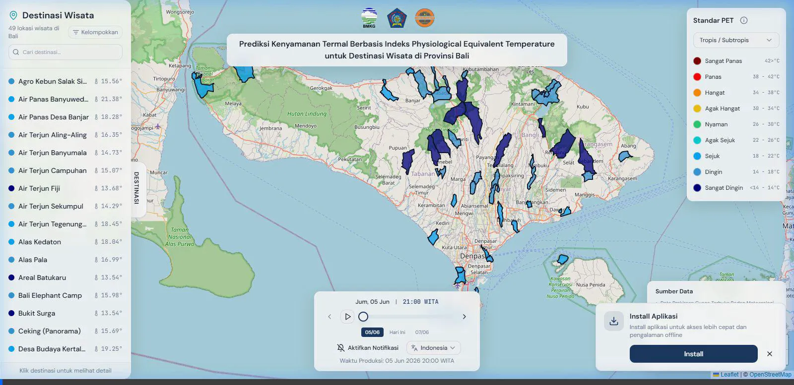
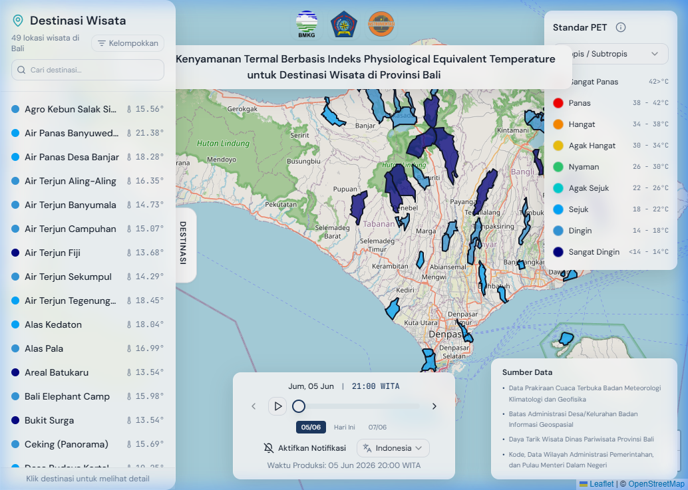
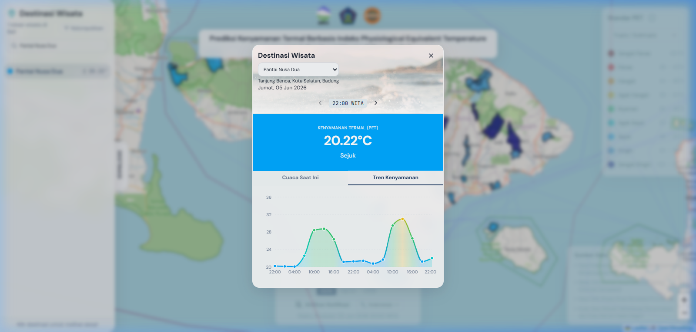

# Bali PET WebGIS

Aplikasi WebGIS interaktif untuk memvisualisasikan prediksi **kenyamanan termal** di berbagai destinasi wisata Bali. Kenyamanan termal dihitung berdasarkan indeks **Physiological Equivalent Temperature (PET)** menggunakan data cuaca historis dan prakiraan.

[](https://react.dev)
[](https://react.dev)
[](https://typescriptlang.org)
[](https://vitest.dev)
[](https://playwright.dev)
[](#)

---

## Demonstrasi Visual

Berikut adalah cuplikan rekaman interaksi langsung pada dasbor WebGIS (memilih bahasa, melihat detail destinasi, dan berpindah tab ke grafik tren kenyamanan):



| Dasbor Utama & Peta Choropleth | Tab Tren Kenyamanan (Suhu vs PET) |
| :---: | :---: |
|  |  |

---

## Tentang Proyek

Proyek ini dibangun sebagai bagian dari penelitian Tugas Akhir (Skripsi) di **Sekolah Tinggi Meteorologi Klimatologi dan Geofisika (STMKG)**. WebGIS ini dirancang untuk membantu wisatawan maupun pengelola destinasi wisata di Provinsi Bali dalam merencanakan aktivitas luar ruangan berdasarkan tingkat kenyamanan termal real-time dan prakiraan.

Peta choropleth merender warna poligon desa berdasarkan kategori kenyamanan PET terpanas (maksimum) dari seluruh destinasi wisata di dalam wilayah administrasi tersebut.

---

## Fitur Utama

- **Peta Interaktif (Leaflet)**: Peta choropleth Bali yang diwarnai dinamis sesuai tingkat kenyamanan termal saat ini.
- **Tab Panel Informasi**: Memisahkan detail cuaca terkini (suhu, kelembapan, kecepatan angin, arah angin, kondisi visual, jarak pandang) dengan grafik tren kenyamanan.
- **Grafik Tren Kenyamanan & Suhu (Recharts)**:
  - Visualisasi PET menggunakan diagram area dengan gradien warna dinamis (merah untuk sangat panas, hijau untuk nyaman, dst.) per titik waktu.
  - Ditambah garis putus-putus (*dashed line*) visualisasi tren Suhu Udara (°C).
  - **Sinkronisasi Waktu Interaktif**: Klik pada titik mana pun di grafik tren untuk menyelaraskan jam aktif dasbor dan peta.
- **Toleransi Waktu (Fuzzy Matching)**: Penanganan data BMKG otomatis dengan pencarian jam terdekat berbasis batas toleransi ±90 menit (`NEAREST_TOLERANCE_MS`).
- **Sidebar Destinasi**: Dilengkapi pencarian nama, pintasan sorot ke peta, serta pengelompokan per wilayah kabupaten/kecamatan.
- **PWA & Offline Caching**: Dukungan instalasi aplikasi langsung dari browser, manifest, dan service worker siap pakai (*production-ready*).
- **Push Notification**: Berlangganan notifikasi otomatis saat batch data prakiraan cuaca baru selesai diproduksi oleh backend.

---

## Prasyarat (Prerequisites)

Sebelum mulai menjalankan aplikasi secara lokal, pastikan perangkat Anda sudah terinstal:
- **Node.js** (versi 18 ke atas)
- Browser modern dengan dukungan Geolocation dan Web Push (seperti Chrome, Edge, atau Firefox)

---

## Panduan Instalasi & Penggunaan

1. **Unduh repositori dan masuk ke folder proyek**:
   ```bash
   cd webgis
   ```

2. **Instal dependensi package**:
   ```bash
   npm install
   ```

3. **Konfigurasi Environment**:
   Buat file baru bernama `.env.local` di folder root `webgis/` dan isi variabel berikut:
   ```env
   VITE_SUPABASE_URL=your_supabase_project_url
   VITE_SUPABASE_ANON_KEY=your_supabase_anon_key
   VITE_VAPID_PUBLIC_KEY=your_vapid_public_key
   ```

4. **Jalankan aplikasi di mode pengembangan (lokal)**:
   ```bash
   npm run dev
   ```
   Aplikasi akan berjalan secara lokal di [http://localhost:8080](http://localhost:8080).

5. **Build proyek untuk mode produksi**:
   ```bash
   npm run build
   npm run preview
   ```

---

## Pengujian & Testing

Dasbor ini dilengkapi dua jenis verifikasi otomatis:

### 1. Unit Testing (Vitest)
Digunakan untuk menguji logika bisnis deterministik (seperti konversi WITA, perhitungan fuzzy matching, pengelompokan menu, kamus bahasa, dan klasifikasi PET):
```bash
npm run test
```

### 2. End-to-End (E2E) Testing (Playwright)
Menguji alur interaksi antarmuka pengguna pada browser Chromium nyata (seperti memuat peta Leaflet, berganti bahasa, memicu pop-up dari klik sidebar, dan klik grafik tren):
```bash
# Instal browser biner Playwright jika pertama kali
npx playwright install chromium

# Jalankan semua pengujian E2E
npm run test:e2e
```

---

## Kontribusi & Hak Cipta

Proyek ini bersifat **private** (tertutup). Seluruh hak cipta dilindungi oleh penulis dan Sekolah Tinggi Meteorologi Klimatologi dan Geofisika (STMKG). 

Hubungi penulis jika ada pertanyaan lebih lanjut terkait penelitian ini:
*   **Nama**: Ahmad Meijlan Yasir
*   **Email**: yasirahmad220504@gmail.com
*   **Instansi**: Sekolah Tinggi Meteorologi Klimatologi dan Geofisika (STMKG), Tangerang.
