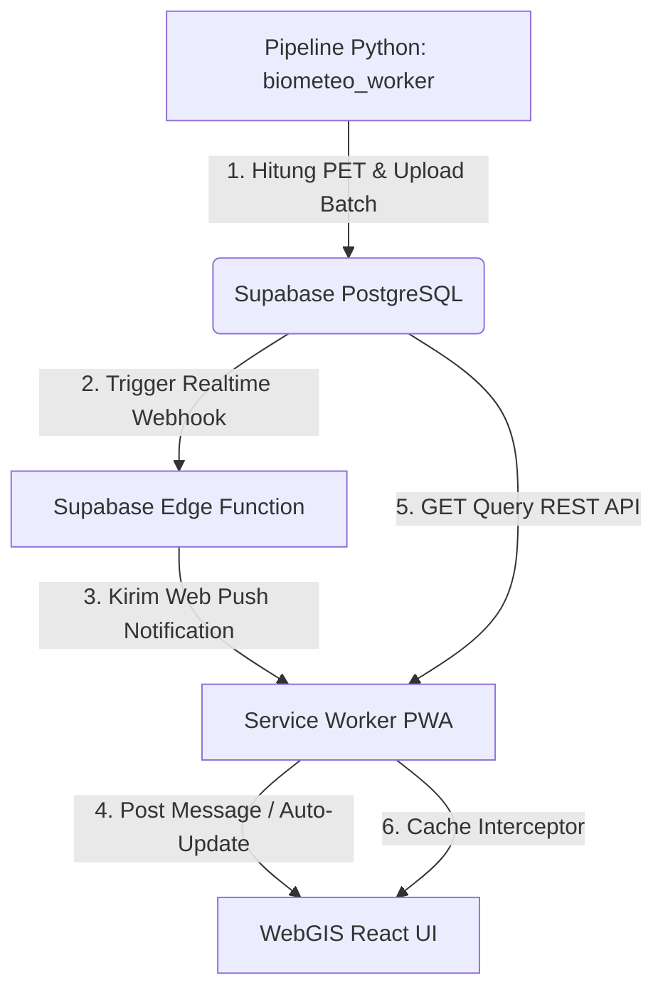

# Bali PET WebGIS

Aplikasi WebGIS interaktif berbasis PWA (*Progressive Web App*) untuk memvisualisasikan prediksi **kenyamanan termal** di berbagai destinasi wisata Provinsi Bali. Kenyamanan termal dihitung secara spasial dan temporal berdasarkan indeks **Physiological Equivalent Temperature (PET)** menggunakan integrasi data cuaca dari BMKG dan database Supabase.

Proyek ini dikembangkan sebagai bagian dari penelitian Tugas Akhir (Skripsi) di **Sekolah Tinggi Meteorologi Klimatologi dan Geofisika (STMKG)**.

[](https://react.dev)
[](https://vite.dev)
[](https://typescriptlang.org)
[](https://vitest.dev)
[](https://playwright.dev)
[](https://tailwindcss.com)
[](#)

---

## Daftar Isi
- [Demonstrasi Visual](#demonstrasi-visual)
- [Tentang Proyek](#tentang-proyek)
- [Arsitektur & Aliran Data](#arsitektur--aliran-data)
- [Struktur Direktori Proyek](#struktur-direktori-proyek)
- [Fitur Utama](#fitur-utama)
- [Spesifikasi Teknologi (Tech Stack)](#spesifikasi-teknologi-tech-stack)
- [Panduan Instalasi & Penggunaan](#panduan-instalasi--penggunaan)
- [Pengujian & Penjaminan Kualitas (Testing)](#pengujian--penjaminan-kualitas-testing)
  - [1. Pengujian Unit (Vitest)](#1-pengujian-unit-vitest)
  - [2. Pengujian End-to-End (Playwright)](#2-pengujian-end-to-end-playwright)
- [Offline Mode & PWA Architecture](#offline-mode--pwa-architecture)
- [Kontribusi & Kontak](#kontribusi--kontak)

---

## Demonstrasi Visual

Berikut adalah cuplikan rekaman interaksi langsung pada dasbor WebGIS (memilih bahasa, melihat detail destinasi, dan berpindah tab ke grafik tren kenyamanan):


| Dasbor Utama & Peta Choropleth | Tab Tren Kenyamanan (Suhu vs PET) |
| :---: | :---: |
|  |  |

---

## Tentang Proyek

Sistem informasi geospasial ini dirancang untuk memetakan beban panas (*thermal load*) dan kenyamanan tubuh manusia di ruang terbuka pada destinasi wisata Bali. Peta choropleth merender warna poligon desa berdasarkan kategori kenyamanan PET maksimum dari seluruh objek wisata di dalam wilayah tersebut, memberikan gambaran cepat bagi wisatawan untuk merencanakan waktu kunjungan terbaik.

---

## Arsitektur & Aliran Data

Aplikasi ini mengadopsi pendekatan *offline-first* dengan sinkronisasi real-time:



---

## Struktur Direktori Proyek

Repositori ini ditata secara modular untuk memisahkan logika database, skenario pengujian, dan komponen visual React:

```text
webgis/
├── db/                         # Skema database lokal & eksportir data (PostgreSQL)
│   ├── schema.sql              # Skema tabel dasar, foreign keys, triggers, dan index
│   ├── rls_policies.sql        # Kebijakan Row-Level Security (RLS) untuk keamanan baca-tulis
│   └── push_notifications.sql  # Tabel pendaftaran push notification VAPID
├── e2e/                        # Skenario pengujian integrasi visual (Playwright E2E)
│   └── webgis.spec.ts          # Rangkaian tes 5 skenario utama lintas browser
├── public/                     # Aset statis public (tidak dibundel oleh compiler)
│   ├── data/                   # File GeoJSON batas administrasi desa/kelurahan Bali
│   ├── icons/                  # Ikon resolusi tinggi & logo splash PWA
│   ├── sw.js                   # Service Worker utama (Caching & Push Message handler)
│   └── manifest.json           # Manifest PWA untuk instalasi di Android/iOS/Desktop
├── src/                        # Kode sumber React & TypeScript utama
│   ├── assets/                 # Logo instansi pendukung format WebP terkompresi
│   ├── components/             # Komponen UI modular
│   │   ├── ui/                 # Komponen UI visual dasar (Button, Dialog, Accordion via shadcn)
│   │   ├── map/                # Komponen rendering peta Leaflet (LeafletMap.tsx)
│   │   ├── chart/              # (Recharts) Visualisasi grafik tren kenyamanan
│   │   ├── sidebar/            # Panel pencarian & daftar destinasi wisata (DestinationSidebar.tsx)
│   │   ├── popup/              # Detail parameter cuaca & saran aktivitas (WeatherPopup.tsx)
│   │   ├── pwa/                # Prompt dialog instalasi PWA (InstallPrompt.tsx)
│   │   └── notifications/      # Tombol toggle pendaftaran notifikasi push
│   ├── data/                   # Adapter API database (supabaseQueries.ts)
│   ├── hooks/                  # React Hooks kustom (geolocation, monitoring batch realtime, dsb)
│   ├── lib/                    # Utilitas global (i18n, timezone, pushNotification, pet)
│   ├── pages/                  # Halaman dasbor utama (Index.tsx)
│   ├── test/                   # Setup pengujian unit & mocks (Vitest)
│   ├── App.tsx                 # Entrypoint utama router aplikasi
│   └── main.tsx                # File inisialisasi React ke DOM
├── supabase/                   # Konfigurasi lokal Supabase & Edge Functions
└── vite.config.ts              # Konfigurasi bundler Vite dan Vitest
```

---

## Fitur Utama

- **Peta Choropleth Dinamis (Leaflet)**: Visualisasi spasial tingkat kenyamanan menggunakan basemap **OpenStreetMap (OSM)** yang responsif terhadap perubahan waktu.
- **Grafik Tren Kenyamanan (Recharts)**: Diagram area bergradien warna dinamis sesuai kategori kenyamanan termal PET diiringi garis putus-putus (*dashed line*) untuk tren suhu udara (°C).
- **Sinkronisasi Waktu Interaktif**: Mengklik titik mana pun pada grafik tren akan menyelaraskan jam aktif dasbor dan peta secara global.
- **Toleransi Pencocokan Waktu (Fuzzy Matching)**: Penanganan ketidakcocokan waktu data BMKG melalui pencarian data terdekat dengan batas toleransi ±90 menit.
- **Pre-fetching Gambar Paralel (Offline-First)**: Secara otomatis mengunduh **49 gambar destinasi wisata** ke cache lokal browser (`bali-pet-images-v1`) pada saat inisialisasi peta guna mencegah gambar rusak saat luring.
- **Service Worker Auto-Update**: Mendeteksi push notifikasi batch data cuaca baru dan memicu pembaruan data di latar belakang tanpa mengharuskan pengguna memuat ulang halaman secara manual.
- **Optimasi Produksi (Zero Logs)**: Menonaktifkan log konsol browser (`console.log`, `console.debug`) di lingkungan produksi secara otomatis untuk privasi data dan peningkatan kinerja.

---

## Spesifikasi Teknologi (Tech Stack)

*   **UI Library**: React v18.3.1
*   **Bahasa Pemrograman**: TypeScript v5.8.3
*   **Bundler & Test Runner**: Vite v7.3.0 + SWC Compiler
*   **Styling**: Tailwind CSS v3.4.17 + shadcn/ui
*   **Mapping Engine**: Leaflet v1.9.4 + React-Leaflet
*   **Database Cloud**: Supabase (PostgreSQL)

---

## Panduan Instalasi & Penggunaan

### 1. Prasyarat
Pastikan komputer Anda sudah terinstal:
*   [Node.js](https://nodejs.org) (Versi 18.x ke atas)
*   [Git](https://git-scm.com)

### 2. Instalasi Dependensi
Kloning atau buka folder proyek `webgis`, kemudian pasang seluruh modul dependensi:
```bash
cd webgis
npm install
```

### 3. Konfigurasi Environment
Buat berkas `.env.local` di direktori root `webgis/` dan masukkan konfigurasi Supabase Anda:
```env
VITE_SUPABASE_URL=https://proyek-anda.supabase.co
VITE_SUPABASE_ANON_KEY=token_anonim_supabase_anda
VITE_VAPID_PUBLIC_KEY=kunci_publik_push_notifikasi_anda
```

### 4. Menjalankan di Server Lokal
Mulai server pengembangan lokal:
```bash
npm run dev
```
Aplikasi akan berjalan di alamat [http://127.0.0.1:8080](http://127.0.0.1:8080).

### 5. Build Produksi
Lakukan build kompilasi produksi untuk menghasilkan bundel kode teroptimasi:
```bash
npm run build
npm run preview
```

---

## Pengujian & Penjaminan Kualitas (Testing)

Aplikasi WebGIS dilengkapi dengan dua metode pengujian komprehensif untuk memastikan seluruh alur fungsi berjalan stabil:

### 1. Pengujian Unit (Vitest)
Digunakan untuk memverifikasi logika deterministik (seperti fuzzy matching waktu, konversi timezone WITA, klasifikasi PET, multibahasa, dan state toggle notifikasi).
*   **Cakupan**: **61 skenario pengujian** dengan **100% Code Coverage** (Statements, Branches, Functions, Lines) pada modul logika kritis.
*   **Perintah menjalankan tes**:
    ```bash
    # Eksekusi tes unit biasa (CLI)
    npm run test

    # Jalankan tes unit beserta pembuatan laporan coverage
    npm run test:coverage

    # Jalankan tes unit dengan dasbor Vitest UI interaktif di browser
    npm run test:ui
    ```

### 2. Pengujian End-to-End (Playwright)
Menguji interaksi antarmuka pengguna pada browser asli (**Chromium**, **Firefox**, dan **WebKit**) secara berurutan menggunakan 3 workers guna menjamin keandalan eksekusi tanpa kebocoran resource.
*   **Cakupan**: **15 pengujian** (5 skenario di masing-masing dari 3 peramban pengujian):
    1.  **Skenario 1: Halaman Utama** - Memastikan peta choropleth Leaflet terpasang di DOM dan sidebar utama terlihat.
    2.  **Skenario 2: Klik Sidebar Destinasi & Membuka Pop-up Cuaca** - Mengklik destinasi pertama dan memastikan pop-up detail cuaca terbuka dengan benar.
    3.  **Skenario 3: Interaksi Grafik Tren PET & Sinkronisasi Waktu** - Mensimulasikan gerakan pointer hover dan klik pada grafik tren Recharts untuk menyinkronkan waktu dasbor global, dilengkapi tombol navigasi waktu sebagai fallback.
    4.  **Skenario 4: Selektor Standar PET** - Mengganti klasifikasi iklim (Sedang/Tropis) via dropdown legenda pada layout responsif (desktop/mobile).
    5.  **Skenario 5: Pergantian Bahasa** - Mengubah bahasa aplikasi (Indonesia/Inggris) timbal-balik dan memvalidasi translasi seluruh teks UI secara langsung.
*   **Perintah menjalankan tes**:
    ```bash
    # Instal browser biner Playwright (jika pertama kali)
    npx playwright install

    # Jalankan pengujian E2E (mode headless)
    npm run test:e2e

    # Jalankan pengujian E2E dengan Playwright UI Mode interaktif
    npm run test:e2e:ui
    ```

### 3. Pemeliharaan Kode (Code Maintenance)
Baris komentar dalam kode sumber (`webgis/src/`) telah disederhanakan untuk menjaga keterbacaan tingkat tinggi, menghilangkan catatan penjelasan baris-demi-baris yang redundan (AI-generated) tanpa mempengaruhi fungsionalitas dan reaktivitas komponen dasbor WebGIS.

---

## Offline Mode & PWA Architecture

Aplikasi ini menggunakan teknologi Progressive Web App (PWA) untuk mendukung akses luring penuh (*fully offline support*):
1.  **Caching Strategis**:
    *   `CACHE_NAME` (`bali-pet-v1`): Menyimpan aset statis yang stabil (HTML, manifest, ikon splash screen, GeoJSON peta).
    *   `IMAGE_CACHE` (`bali-pet-images-v1`): Menyimpan gambar objek wisata yang di-prefetch secara paralel di latar belakang.
    *   `API_CACHE` (`bali-pet-api-v1`): Menyimpan respons data JSON prakiraan cuaca dari Supabase REST API menggunakan strategi *Network-First falling back to Cache*.
2.  **Penanganan Luring Komponen Peta**:
    Service worker mengintersept kegagalan unduhan ubin peta OpenStreetMap (OSM) saat offline dan mengembalikan status `503 Service Unavailable` secara anggun alih-alih memicu uncaught promise rejection pada peta Leaflet.
3.  **Penanganan Luring WebSocket**:
    Hook monitoring batch data Supabase mendeteksi status `navigator.onLine` untuk secara dinamis melepas koneksi WebSocket saat offline untuk mencegah konsumsi berlebih pada konsol error peramban.

---

## Kontribusi & Kontak

Proyek ini bersifat tertutup (private) untuk kepentingan Tugas Akhir. Hubungi penulis apabila memiliki pertanyaan terkait sistem ini:

*   **Nama**: Ahmad Meijlan Yasir
*   **Email**: yasirahmad220504@gmail.com
*   **Instansi**: Sekolah Tinggi Meteorologi Klimatologi dan Geofisika (STMKG), Tangerang.

