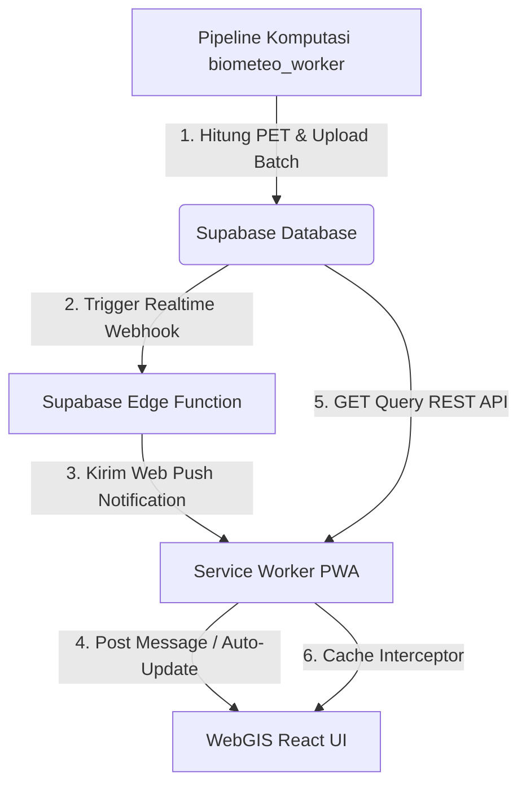
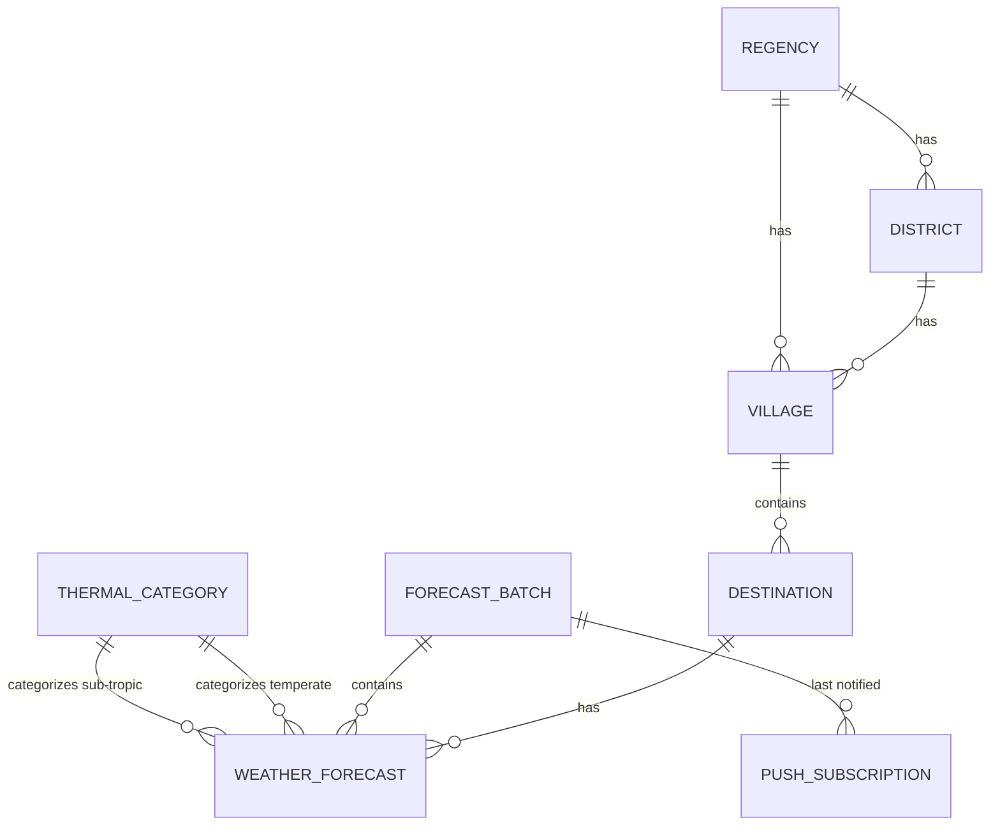

# Rangkuman Komprehensif Proyek: Bali PET WebGIS

Dokumen ini menyajikan rangkuman menyeluruh, mendalam, dan terstruktur mengenai seluruh aspek teknis, arsitektur, fitur, basis data, dan sistem pengujian dari aplikasi **Bali PET WebGIS**. 

Proyek ini dikembangkan sebagai bagian dari penelitian Tugas Akhir (Skripsi) di **Sekolah Tinggi Meteorologi Klimatologi dan Geofisika (STMKG)**. Aplikasi ini dirancang untuk memprediksi, mengklasifikasi, dan memvisualisasikan tingkat kenyamanan termal secara spasial dan temporal di berbagai destinasi wisata Provinsi Bali menggunakan indeks **Physiological Equivalent Temperature (PET)**.

---

## 1. Arsitektur Sistem & Aliran Data

Aplikasi ini menggunakan integrasi arsitektur modern berbasis layanan awan (Supabase) dan kapabilitas offline-first (PWA) untuk memastikan keandalan penyajian informasi cuaca bagi wisatawan.

### A. Diagram Aliran Data Utama



1.  **Penyediaan Data**: Pipeline backend (`biometeo_worker` di repositori `action`) secara berkala mengambil parameter cuaca dari BMKG, menghitung nilai indeks PET menggunakan modul komputasi termal, dan mengunggah batch data ke Supabase.
2.  **Pemantauan Real-time**: Dasbor utama memantau perubahan batch terbaru via Supabase Realtime Channel atau Service Worker postMessage.
3.  **Caching offline-first**: Seluruh data spasial (GeoJSON), aset statis web, gambar destinasi, dan data cuaca di-cache oleh Service Worker di browser pengguna untuk memastikan dasbor dapat berjalan dalam kondisi offline penuh.

---

## 2. Struktur Direktori Kode Sumber

Berikut adalah pemetaan struktural dari folder `webgis/` beserta fungsi dari setiap subdirektori penting:

```text
webgis/
├── db/                         # Skema SQL database, kebijakan RLS, & dummy data exporter
│   ├── schema.sql              # Definisi tabel dasar, foreign keys, triggers, dan index
│   ├── rls_policies.sql        # Aturan Row-Level Security untuk izin baca-tulis
│   └── push_notifications.sql  # Tabel dan fungsi khusus registrasi Push Notification
├── e2e/                        # Skenario pengujian integrasi visual & interaksi UI (Playwright)
├── public/                     # Aset statis public yang tidak ikut dibundel
│   ├── data/                   # File GeoJSON batas administrasi desa/kelurahan Bali
│   ├── icons/                  # Logo branding aplikasi PWA (STMKG & Instrumentasi)
│   ├── favicon.ico             # Favicon multi-resolusi (16px, 32px, 48px, 64px)
│   ├── image-fallback.webp     # Aset fallback lokal untuk error penanganan gambar
│   └── sw.js                   # Service Worker utama untuk PWA & Offline Caching
├── src/                        # Sumber utama kode React & TypeScript
│   ├── assets/                 # Aset internal (Logo STMKG & Instrumentasi format WebP)
│   ├── components/             # Komponen UI modular
│   │   ├── ui/                 # Komponen UI visual dasar (Button, Dialog, Accordion, dll)
│   │   ├── map/                # Komponen rendering peta Leaflet (LeafletMap.tsx)
│   │   ├── chart/              # (Recharts) Visualisasi grafik tren kenyamanan
│   │   ├── sidebar/            # Panel pencarian & daftar destinasi wisata (DestinationSidebar.tsx)
│   │   ├── popup/              # Pop-up detail parameter cuaca & saran aktivitas (WeatherPopup.tsx)
│   │   ├── pwa/                # Komponen prompt instalasi PWA responsif (InstallPrompt.tsx)
│   │   ├── header/             # Header navigasi & logo instansi (MapHeader.tsx)
│   │   └── notifications/      # Tombol aktivasi dan registrasi notifikasi push
│   ├── data/                   # Kueri database & integrasi client Supabase
│   │   └── supabaseQueries.ts  # Adapter kueri PostgreSQL/Supabase
│   ├── hooks/                  # React Hooks kustom (geolocation, monitoring batch realtime, dsb)
│   ├── lib/                    # Utilitas global
│   │   ├── i18n.tsx            # Pelokalan bahasa dinamis (Indonesia / English)
│   │   ├── pet.ts              # Logika klasifikasi nilai PET & rentang warna
│   │   ├── forecastTime.ts     # Utilitas filter jam dan fuzzy matching ±90 menit
│   │   ├── pushNotification.ts # Layanan registrasi notifikasi VAPID browser
│   │   └── timezone.ts         # Penanganan konversi waktu lokal WITA (UTC+8)
│   ├── test/                   # Setup pengujian unit (Vitest)
│   ├── App.tsx                 # Entrypoint utama struktur router aplikasi
│   └── main.tsx                # File inisialisasi React ke DOM
├── supabase/                   # Konfigurasi Supabase lokal & Edge Functions
│   ├── config.toml             # Konfigurasi lingkungan Supabase
│   └── functions/              # Daftar Edge Functions (TypeScript)
│       └── send-push-notification/ # Fungsi kirim notifikasi push ke Web-Push
├── package.json                # Daftar dependensi modul & script CLI project
├── tailwind.config.ts          # Kustomisasi utility styling visual HSL
└── vite.config.ts              # Konfigurasi bundler Vite dan Vitest
```

---

## 3. Spesifikasi Teknologi (Tech Stack)

Aplikasi dibangun menggunakan stack teknologi modern berkinerja tinggi untuk menjamin kelancaran jalannya WebGIS pada perangkat berspesifikasi rendah sekalipun:

| Kategori | Teknologi | Keterangan / Justifikasi |
| :--- | :--- | :--- |
| **Framework Inti** | React (v18.3.1) + TypeScript (v5.8.3) | Mengamankan struktur tipe data dan reaktivitas komponen. |
| **Bundler** | Vite (v7.3.0) + `@vitejs/plugin-react-swc` | Compiler berbasis Rust untuk loading & build super cepat. |
| **Styling** | Tailwind CSS (v3.4.17) + `shadcn/ui` | Memungkinkan visualisasi premium bertema *glassmorphism* dan warna adaptif. |
| **Mapping Engine** | Leaflet (v1.9.4) + `@types/leaflet` | Rendering peta choropleth berbasis canvas ringan untuk performa tinggi. |
| **Visualisasi Tren**| Recharts (v2.15.4) | Visualisasi grafik area interaktif bersinkronisasi waktu. |
| **Database & API** | Supabase (PostgreSQL) | Menyediakan REST API otomatis, otentikasi, dan realtime server-sent events. |
| **Unit Testing** | Vitest (v4.1.5) + jsdom | Menguji seluruh pure-logic dan rendering komponen secara cepat. |
| **E2E Testing** | Playwright (v1.60.0) | Menjamin alur interaksi pengguna berjalan sempurna di berbagai browser asli. |

---

## 4. Basis Data (Database Schema & Security)

Database yang digunakan telah dinormalisasi untuk mendukung efisiensi kueri pipeline dan visualisasi WebGIS.

### A. Hubungan Antar Tabel (Entity-Relationship)



### B. Deskripsi Tabel Utama

1.  **`thermal_categories`**: Menyimpan metadata kategori kenyamanan termal (kunci kategori seperti `very_hot`, `hot`, `neutral` serta nama kategori).
2.  **`regencies` & `districts`**: Tabel pembagian wilayah administratif tingkat II (Kabupaten) dan tingkat III (Kecamatan) di Provinsi Bali.
3.  **`villages`**: Tabel batas wilayah desa/kelurahan yang memetakan kolom `kdepum_code` (kode resmi Kemendagri dengan tanda titik) ke kode poligon GeoJSON.
4.  **`destinations`**: Daftar 49 daya tarik wisata (destinasi) lengkap dengan koordinat spasial (latitude, longitude), elevasi/tinggi dari permukaan laut (sea level height), dan URL gambar.
5.  **`forecast_batches`**: Metadata produksi data. Field `is_latest` (Boolean) diatur unik menggunakan indeks kondisional PostgreSQL agar hanya ada 1 batch aktif yang menjadi acuan WebGIS saat itu.
6.  **`weather_forecasts`**: Data deret waktu berisi parameter cuaca lengkap (suhu udara, kelembapan, kecepatan & arah angin, kondisi awan, jarak pandang, nilai PET, dan rujukan foreign key kategori termal).
7.  **`push_subscriptions`**: Menyimpan token registrasi browser untuk menerima push notification (menyimpan endpoint, kunci public key `p256dh`, dan kode `auth`).

### C. Kebijakan Row-Level Security (RLS)
Untuk melindungi integritas database dari modifikasi tidak sah oleh pihak luar, RLS diaktifkan penuh di seluruh tabel dengan aturan sebagai berikut:

*   **Akses SELECT (Anonim/Publik)**: Diizinkan di semua tabel (`true`) agar WebGIS dapat langsung mengunduh data cuaca secara transparan tanpa otentikasi login.
*   **Akses INSERT/UPDATE/DELETE**: Diblokir penuh untuk peran publik anonim. Hanya dapat dimodifikasi oleh admin atau pipeline backend (`service_role` / postgres superuser).
*   **Push Subscriptions**: Mengizinkan peran publik untuk melakukan `INSERT` (registrasi token baru) dan `UPDATE` (mengubah status aktif notifikasi) guna mendukung pengelolaan langganan langsung dari browser.
*   **Security Invoker**: Seluruh view database PostgreSQL diatur menggunakan opsi `WITH (security_invoker = true)` agar aturan RLS tabel dasar tetap dievaluasi saat diakses lewat view.

---

## 5. Fitur Utama & Fungsionalitas Dasbor

Dasbor utama menyajikan peta visual dan panel detail yang sangat interaktif:

### A. Peta Choropleth Desa Interaktif
*   Peta membaca GeoJSON batas administrasi desa di Provinsi Bali.
*   Poligon diwarnai secara spasial (Choropleth) berdasarkan **nilai PET terpanas (maksimum)** dari destinasi wisata yang terletak di dalam desa tersebut. Hal ini memberikan estimasi perlindungan suhu terburuk (skenario terpanas) bagi wisatawan.
*   Poligon desa yang memiliki destinasi wisata tetapi belum memiliki data cuaca diwarnai abu-abu (`#9ca3af`), sementara desa non-destinasi diwarnai abu-abu transparan (`#e5e5e5`) sebagai latar belakang pasif.
*   Peta membatasi pergeseran layar menggunakan batas wilayah (`BALI_BOUNDS`) untuk mencegah user menggeser peta terlalu jauh (menghemat penggunaan memori web).

### B. Inisialisasi Waktu Cerdas (Smart Default Time)
Saat dasbor dimuat pertama kali, aplikasi tidak menampilkan slot jam paling awal di dalam database (yang mungkin berada di masa lampau), melainkan secara dinamis menghitung selisih terkecil antara waktu lokal perangkat pengguna (`Date.now()`) dengan deretan waktu prakiraan. Aplikasi langsung mengaktifkan slot waktu terdekat tersebut secara otomatis.

### C. Penanganan Toleransi Waktu (Fuzzy Matching)
Dalam pencarian data parameter cuaca per destinasi, aplikasi menggunakan utilitas `nearestForecast` dengan konstanta `NEAREST_TOLERANCE_MS` sebesar ±90 menit. Jika jam aktif dasbor tidak tepat sama dengan waktu prakiraan dari database, sistem akan mencari data terdekat dalam rentang toleransi tersebut. Ini memastikan peta tidak kosong atau menghasilkan error di UI saat slider digeser.

### D. WeatherPopup (Pop-up Detail Destinasi)
Ketika poligon desa atau destinasi di sidebar diklik, pop-up interaktif muncul dengan fungsionalitas:
*   **Tab "Detail Cuaca"**: Menyajikan parameter cuaca meteorologi lengkap:
    *   Suhu Udara (°C) dan Kelembapan (%).
    *   Kecepatan angin dalam format adaptif (`km/jam` untuk ID, `km/h` untuk EN) dan arah angin (sudut derajat beserta arah kompas kardinalnya).
    *   Ikon & deskripsi cuaca BMKG dan Jarak Pandang (km).
    *   Saran Aktivitas Wisatawan otomatis berdasarkan klasifikasi kenyamanan termal PET.
*   **Tab "Tren Kenyamanan"**: Merender grafik garis area (AreaChart) dari Recharts:
    *   Garis gradien warna menyesuaikan klasifikasi kategori PET (dari hijau nyaman hingga merah sangat panas).
    *   Garis putus-putus (*dashed line*) untuk tren suhu udara.
    *   **Sinkronisasi Waktu Dua Arah**: Wisatawan dapat mengklik titik mana pun pada grafik tren di dalam popup. Tindakan ini akan secara instan mengubah jam aktif dasbor utama dan memperbarui visualisasi choropleth di peta tanpa menutup pop-up.

### E. Fallback Gambar Terintegrasi (Service Worker-assisted)
Untuk mencegah kegagalan render gambar destinasi wisata (misalnya akibat hilangnya koneksi internet atau url gambar kedaluwarsa), komponen `WeatherPopup` mengimplementasikan fallback visual terenkapsulasi. Jika pemuatan gambar dari Supabase Storage gagal (`onError`), Service Worker secara instan mengarahkan request ke `/image-fallback.webp` yang telah tersimpan di cache lokal browser, menyajikan gambar pemandangan indah Bali tanpa menampilkan ikon gambar rusak.

### F. Pelokalan Bahasa Dinamis (i18n)
Aplikasi mendukung dual bahasa (Indonesia & English) secara penuh di seluruh elemen dasbor, termasuk deskripsi status kenyamanan, konversi unit angin, saran untuk wisatawan, notifikasi toast, hingga pesan aksesibilitas browser (aria-labels). Bahasa terpilih disimpan di `localStorage` agar tetap persisten saat halaman dimuat ulang.

---

## 6. Fitur PWA (Progressive Web App) & Service Worker

Dasbor dirancang dengan standar PWA modern agar dapat diinstal di desktop maupun perangkat seluler.

### A. Ikon & Branding STMKG/Instrumentasi
Aplikasi menggunakan ikon bertema STMKG dengan pendekatan khusus:
*   **Standard Icons**: Menggunakan latar belakang transparan untuk penampilan bersih di sistem operasi desktop.
*   **Maskable Icons**: Menggunakan latar belakang putih solid dengan logo STMKG berukuran maksimum 70% dari kanvas (terpusat). Hal ini memastikan ikon tidak terpotong secara visual (*safe zone*) ketika dipotong menjadi bentuk lingkaran atau persegi melengkung oleh sistem Android dan iOS.

### B. Prompt Instalasi Responsif
*   Komponen `InstallPrompt.tsx` melacak status instalasi browser.
*   Petunjuk instalasi dirancang responsif: melayang proporsional di kanan bawah (`w-96` / 384px) pada layar desktop, dan melebar seimbang di bagian bawah layar pada perangkat seluler.
*   **Auto-Close Timer**: Prompt akan otomatis menutup secara lembut dalam waktu 6 detik (`AUTO_CLOSE_DELAY`) jika didiamkan oleh pengguna, menjaga kebersihan ruang interaksi peta. Prompt tidak akan dimunculkan kembali selama 7 hari ke depan jika pengguna memilih untuk menutupnya (dismiss).

### C. Strategi Caching Service Worker (`sw.js`)
Service worker mengelola caching menggunakan empat kategori penyimpanan terpisah untuk efisiensi transfer data:

1.  **Stable Assets Cache (`bali-pet-v3`)**: Menyimpan file statis utama yang tidak berubah nama saat kompilasi build (`/`, `/manifest.json`, `/favicon.ico`, GeoJSON, dan `/image-fallback.webp`).
2.  **Hashed Assets Cache (`bali-pet-runtime-v3`)**: Menyimpan file keluaran kompilasi Vite (`/assets/*.js`, `/assets/*.css`). Cache berstrategi *Cache-First* karena setiap perubahan kode di sisi developer akan mengubah nama hash file, menjamin pengguna selalu mendapatkan versi terbaru tanpa konflik cache.
3.  **Images & Map Tiles Cache (`bali-pet-images-v3`)**: Menyimpan ubin peta OpenStreetMap dan gambar destinasi. Menggunakan strategi *Cache-First* untuk mengurangi waktu loading peta secara drastis saat dibuka berulang kali.
4.  **Supabase REST API Cache (`bali-pet-api-v3`)**: Menyimpan respon kueri data cuaca Supabase. Menggunakan strategi *Network-First* dengan fallback cache. Jika pengguna offline, data cuaca terakhir tetap disajikan dari cache lokal.

### D. PWA Auto-Update Real-time (Zero Refresh)
Aplikasi mendengarkan pesan `NEW_BATCH_NOTIFICATION` dari Service Worker. Jika ada push notification batch cuaca baru masuk ke perangkat di latar belakang, Service Worker akan mengirimkan event `postMessage` ke browser. Aplikasi akan otomatis mendeteksi perubahan `updated_at` batch di Supabase dan langsung memproses ulang kueri data cuaca terbaru di dasbor tanpa memerlukan tindakan *refresh* browser manual dari pengguna.

---

## 7. Optimasi Produksi & Keamanan

*   **Pembersihan Log Produksi**: Pada lingkungan build produksi, semua fungsi `console.log`, `console.debug`, dan sejenisnya dinonaktifkan secara global melalui konfigurasi interceptor JavaScript guna meningkatkan kinerja render browser dan melindungi informasi sistem dari pembacaan log publik.
*   **Kompatibilitas WebView Android**: Konfigurasi target kompilasi bundler di `vite.config.ts` diturunkan secara spesifik ke `es2018` dan `chrome61` (beserta `cssTarget: 'chrome61'`). Konfigurasi ini menjamin WebGIS berjalan lancar tanpa layar putih (*white screen*) di WebView perangkat Android lama.

---

## 8. Sistem Pengujian & Penjaminan Mutu (QA)

Aplikasi memiliki infrastruktur testing yang kuat untuk memastikan keandalan fungsi bisnisnya. Pengujian dibagi menjadi dua metode utama: **Unit Testing (Vitest)** dan **End-to-End Testing (Playwright)**.

### A. Pengujian Unit (Unit Testing - Vitest)
Menjalankan total **61 skenario pengujian unit** secara otomatis menggunakan Vitest. Berikut adalah rincian lengkap dari setiap berkas pengujian beserta seluruh skenario uji yang tercakup:

#### 1. timezone.test.ts (3 Skenario)
*   **Skenario 1**: `toWitaDate shifts to UTC+8 display basis` - Memverifikasi bahwa fungsi konversi menggeser objek tanggal ke basis tampilan WITA (UTC+8) dengan tepat.
*   **Skenario 2**: `isSameWitaDay compares day in WITA` - Memastikan perbandingan tanggal dilakukan dalam perspektif hari WITA untuk menghindari error akibat perbedaan offset zona waktu.
*   **Skenario 3**: `toWitaDate accepts Date input` - Menguji fungsi `toWitaDate` agar dapat menerima objek `Date` langsung selain string format ISO.

#### 2. pet.test.ts (6 Skenario)
*   **Skenario 1**: `temperate boundaries` - Validasi klasifikasi tingkat kenyamanan termal untuk iklim sedang pada batas-batas kritis (misal: 18°C, 23°C, 29°C, 35°C).
*   **Skenario 2**: `tropical boundaries` - Validasi klasifikasi kenyamanan termal khusus wilayah tropis/subtropis (misal: nyaman di rentang 26°C - 30°C).
*   **Skenario 3**: `non-finite returns neutral` - Memastikan nilai input non-finite (seperti `NaN` atau `Infinity`) dikembalikan sebagai kategori `neutral` secara aman.
*   **Skenario 4**: `temperate covers all categories` - Menjamin rentang suhu mencakup semua 9 kategori termal iklim sedang secara berkelanjutan tanpa celah (overlap).
*   **Skenario 5**: `tropical covers all categories` - Menjamin cakupan lengkap 9 kategori termal khusus iklim tropis dari rentang sangat dingin hingga sangat panas.
*   **Skenario 6**: `ranges/colors contain all keys used by UI` - Memastikan semua warna dan label kategori terdaftar di kamus data dan terpetakan sempurna ke UI.

#### 3. i18n.test.tsx (3 Skenario)
*   **Skenario 1**: `defaults to id when storage not en` - Dasbor secara bawaan menggunakan Bahasa Indonesia saat `localStorage` kosong atau bernilai selain 'en'.
*   **Skenario 2**: `reads en from localStorage and setLang persists` - Memverifikasi pilihan Bahasa Inggris dibaca dari `localStorage` saat load awal, dan fungsi `setLang` memperbarui penyimpanan agar pilihan persisten.
*   **Skenario 3**: `useI18n throws if used outside provider` - Proteksi kode yang memastikan hook `useI18n` melempar error jika dirender di luar komponen `I18nProvider`.

#### 4. forecastTime.test.ts (9 Skenario)
*   **Skenario 1**: `returns null on empty list or invalid target` - Mengembalikan `null` jika kueri prakiraan kosong atau parameter target waktu tidak valid.
*   **Skenario 2**: `returns exact match when target exists` - Memastikan pengembalian data cuaca secara instan jika terdapat jam yang cocok secara presisi.
*   **Skenario 3**: `uses first/last candidate when target is outside range` - Memilih slot waktu paling awal atau akhir jika target waktu berada di luar batas rentang batch data.
*   **Skenario 4**: `picks nearest within tolerance` - Memilih data terdekat jika selisih waktu masih di bawah toleransi `NEAREST_TOLERANCE_MS` (90 menit).
*   **Skenario 5**: `returns null if outside tolerance` - Mengembalikan `null` jika tidak ada slot prakiraan terdekat dalam batas toleransi.
*   **Skenario 6**: `picks the right-side candidate when it is closer` - Memilih kandidat waktu di sebelah kanan (waktu masa depan) jika selisihnya lebih kecil dibandingkan kandidat sebelah kiri.
*   **Skenario 7**: `returns empty for empty input` - Fungsi pembentuk deret waktu slider (`buildSliderTimes`) mengembalikan array kosong untuk input kosong.
*   **Skenario 8**: `returns empty when no usable timestamps` - Mengembalikan array kosong jika parameter input tidak memiliki penanda waktu valid.
*   **Skenario 9**: `union of 3-hour sequences from unique earliest starts` - Memastikan deret waktu slider terbentuk dengan interval 3 jam secara urut dimulai dari waktu paling awal dari database.

#### 5. supabaseQueries.test.ts (5 Skenario)
*   **Skenario 1**: `getLatestBatch returns null when no data` - Mengembalikan nilai `null` jika tidak ada batch data cuaca aktif di database.
*   **Skenario 2**: `getForecastTimes returns unique ordered times` - Memastikan deret waktu yang ditarik dari database bersifat unik dan terurut secara kronologis (ascending).
*   **Skenario 3**: `getDestinationsWithVillage maps nested village metadata` - Menguji pemetaan relasi data destinasi dengan desa/kecamatan/kabupaten dari hasil kueri bertingkat (nested) database.
*   **Skenario 4**: `getAllForecastsForBatch returns array` - Memastikan penarikan seluruh data cuaca dari batch mengembalikan bentuk struktur array yang valid.
*   **Skenario 5**: `savePushSubscription returns null on error, removePushSubscription returns false on error` - Penanganan kegagalan kueri push notifications secara aman saat database mengalami gangguan jaringan.

#### 6. WeatherPopup.test.tsx (17 Skenario)
*   **Skenario 1**: `normalizes signed supabase storage URL to public URL without query` - Menjamin URL gambar bertanda tangan (signed URL) dari Supabase dinormalisasi secara otomatis menjadi public URL agar terbebas dari masa kedaluwarsa token.
*   **Skenario 2**: `falls back to default hero image on load error` - Mengganti secara otomatis ke `/image-fallback.webp` ketika browser gagal memuat gambar destinasi.
*   **Skenario 3**: `does not change hero when already using fallback` - Mencegah loop pemuatan ulang (infinite retry) jika pemuatan gambar fallback itu sendiri mengalami kegagalan.
*   **Skenario 4**: `prev/next time buttons call onTimeChange` - Tombol navigasi waktu di dalam pop-up memicu fungsi callback `onTimeChange` secara reaktif.
*   **Skenario 5**: `handlePrev/handleNext no-op at edges` - Tombol dinonaktifkan jika slider berada pada batas awal atau akhir deret waktu.
*   **Skenario 6**: `handlePrev/handleNext no-op when times is empty (currentIndex=-1)` - Tombol tidak melakukan aksi apa pun saat deret waktu kosong.
*   **Skenario 7**: `multi-destination select triggers onDestinationChange` - Dropdown destinasi (untuk desa dengan destinasi > 1) memicu pembaruan state destinasi aktif.
*   **Skenario 8**: `multi-destination select defaults to first destination when selectedDestinationId is missing` - Memilih destinasi pertama secara otomatis jika tidak ada ID destinasi terpilih yang disediakan.
*   **Skenario 9**: `wind direction numeric becomes cardinal+degrees and visibility numeric adds km` - Mengubah nilai sudut angin numerik menjadi teks kardinal dan menambahkan unit satuan 'km' pada visibilitas numerik secara otomatis.
*   **Skenario 10**: `wind direction textual is shown as-is; visibility with units is kept` - Menampilkan arah angin berbasis teks (misal: 'Barat') apa adanya dan menjaga visibilitas yang sudah memiliki satuan.
*   **Skenario 11**: `wind direction negative degrees wraps correctly; visibility non-numeric stays raw` - Menangani sudut arah angin bernilai negatif (modulo 360°) dan membiarkan teks non-numerik pada visibilitas.
*   **Skenario 12**: `visibility non-finite numeric returns raw` - Mengembalikan nilai visibilitas mentah jika input berupa nilai non-finite.
*   **Skenario 13**: `English UI uses label (not labelId) + km/h` - Memastikan tampilan Bahasa Inggris menampilkan label cuaca internasional dan unit angin 'km/h'.
*   **Skenario 14**: `Indonesian UI uses labelId + km/jam and falls back to not_available for empty wind/visibility` - Memastikan tampilan Bahasa Indonesia menggunakan label lokal, unit 'km/jam', dan menampilkan 'Belum tersedia' jika data kosong.
*   **Skenario 15**: `toggling between current and trend tabs and clicking on area chart works` - Memverifikasi transisi tab pada pop-up detail cuaca dan interaksi klik pada grafik tren untuk sinkronisasi waktu dasbor.
*   **Skenario 16**: `renders empty state when chartData is empty in trend tab` - Memastikan grafik tren tidak crash dan merender tampilan kosong secara aman jika data deret waktu kosong.
*   **Skenario 17**: `renders trend tab with single forecast item and toggling language covers gradient and label branches` - Memastikan rendering grafik tren dengan hanya satu item prakiraan dan perubahan bahasa tetap berjalan lancar tanpa error pembagian atau gradien tidak valid.

#### 7. WeatherPopup.reducedMotion.test.tsx (1 Skenario)
*   **Skenario 1**: `renders with reduceMotion=true path` - Memastikan komponen `WeatherPopup` menghentikan rendering animasi transisi visual jika pengguna mengaktifkan pengaturan Reduced Motion pada sistem operasinya.

#### 8. NotificationToggle.test.tsx (11 Skenario)
*   **Skenario 1**: `blocked toast on toggle when permission denied` - Menampilkan toast peringatan ketika pengguna mencoba mengaktifkan notifikasi tetapi izin browser telah diblokir.
*   **Skenario 2**: `unsubscribe failure shows destructive toast` - Menampilkan toast kegagalan saat proses pembatalan langganan notifikasi push di database menemui kendala.
*   **Skenario 3**: `permission default but user does not grant -> toast and no subscribe call` - Menampilkan toast penolakan dan membatalkan panggilan API jika status izin masih default dan pengguna menolak prompt dialog browser.
*   **Skenario 4**: `subscribe failure shows destructive toast` - Menampilkan toast error jika pendaftaran token push baru ke server database Supabase mengalami gangguan.
*   **Skenario 5**: `subscribe path requests permission when default` - Meminta izin notifikasi browser secara resmi apabila status izin sebelumnya masih 'default'.
*   **Skenario 6**: `renders null when push not supported` - Tombol pendaftaran notifikasi tidak dirender di layar jika browser tidak mendukung Push API.
*   **Skenario 7**: `shows blocked when permission denied` - Menampilkan teks dan status tombol dinonaktifkan (blocked) jika izin notifikasi ditolak secara permanen.
*   **Skenario 8**: `toggles unsubscribe path when really active` - Melakukan proses hapus token di database ketika tombol diklik dalam kondisi langganan aktif.
*   **Skenario 9**: `subscribe success shows success toast` - Menampilkan toast keberhasilan saat pendaftaran notifikasi push berhasil disimpan.
*   **Skenario 10**: `catch path shows error toast when permission check throws` - Menangani kegagalan internal browser secara aman menggunakan blok catch.
*   **Skenario 11**: `click does nothing while loading (guard)` - Mencegah klik beruntun (loading guard) selama proses pendaftaran/pembatalan sedang berlangsung.

#### 9. LanguageSelector.test.tsx (1 Skenario)
*   **Skenario 1**: `changes language and persists to localStorage` - Memilih bendera/opsi bahasa memperbarui konteks bahasa aplikasi secara global dan menyimpannya di `localStorage` agar tidak hilang saat refresh.

#### 10. LanguageSelector.handler.test.tsx (1 Skenario)
*   **Skenario 1**: `ignores unknown values and accepts en` - Memastikan pemilih bahasa mengabaikan nilai kode bahasa yang tidak didukung (misal selain 'id' / 'en') dan hanya memproses kode bahasa valid.

#### 11. pushNotification.test.ts (4 Skenario)
*   **Skenario 1**: `isPushNotificationSupported false when missing primitives` - Mendeteksi ketidaktersediaan fitur notifikasi jika objek `serviceWorker` atau `PushManager` tidak terpasang di browser.
*   **Skenario 2**: `getNotificationPermission returns denied when Notification missing` - Mengembalikan nilai status 'denied' jika objek `Notification` primitif tidak dikenali browser.
*   **Skenario 3**: `getCurrentSubscription returns null on error` - Menangani error secara aman dan mengembalikan `null` jika kueri pengambilan langganan aktif dari Service Worker terputus.
*   **Skenario 4**: `unsubscribe returns true when no subscription` - Mengembalikan `true` secara langsung jika pengguna melakukan pembatalan notifikasi padahal memang belum terdaftar (operasi idempoten).

### B. Pengujian End-to-End (E2E Testing - Playwright)
Menjalankan total **12 skenario pengujian E2E** secara otomatis pada tiga mesin browser utama (*Chromium*, *Firefox*, dan *WebKit*) dengan masing-masing 4 skenario sebagai berikut:
*   **Skenario 1**: Memastikan peta Leaflet berhasil dirender dan menampilkan layer poligon destinasi Bali (terpasang di DOM).
*   **Skenario 2**: Memverifikasi fungsionalitas pergantian bahasa (Indonesia/Inggris) di dasbor mengubah seluruh teks UI secara dinamis.
*   **Skenario 3**: Menguji interaksi popup detail destinasi saat poligon peta atau sidebar diklik.
*   **Skenario 4**: Menguji interaksi grafik tren kenyamanan untuk mengubah jam aktif dasbor secara global.

### C. Metrik Cakupan Pengujian (Test Coverage)
Vitest dikonfigurasi dengan provider cakupan kode `v8` untuk melacak baris kode yang diuji. Target cakupan minimal diatur ketat pada modul kritis:
*   **Statements**: 100%
*   **Branches**: 100%
*   **Functions**: 100%
*   **Lines**: 100%

Laporan ringkasan pengujian unit Vitest yang berhasil dicapai:
```text
-------------------|---------|----------|---------|---------|-------------------
File               | % Stmts | % Branch | % Funcs | % Lines | Uncovered Line #s 
-------------------|---------|----------|---------|---------|-------------------
All files          |     100 |      100 |     100 |     100 |                   
 ...nents/controls |     100 |      100 |     100 |     100 |                   
  ...eSelector.tsx |     100 |      100 |     100 |     100 |                   
 .../notifications |     100 |      100 |     100 |     100 |                   
  ...ionToggle.tsx |     100 |      100 |     100 |     100 |                   
 components/popup  |     100 |      100 |     100 |     100 |                   
  WeatherPopup.tsx |     100 |      100 |     100 |     100 |                   
 lib               |     100 |      100 |     100 |     100 |                   
  forecastTime.ts  |     100 |      100 |     100 |     100 |                   
  i18n.tsx         |     100 |      100 |     100 |     100 |                   
  pet.ts           |     100 |      100 |     100 |     100 |                   
  timezone.ts      |     100 |      100 |     100 |     100 |                   
  utils.ts         |     100 |      100 |     100 |     100 |                   
-------------------|---------|----------|---------|---------|-------------------
```

---

*Dokumen ini merupakan panduan teknis internal yang bersifat statis dan tidak untuk dipublikasikan ke repositori git publik.*
